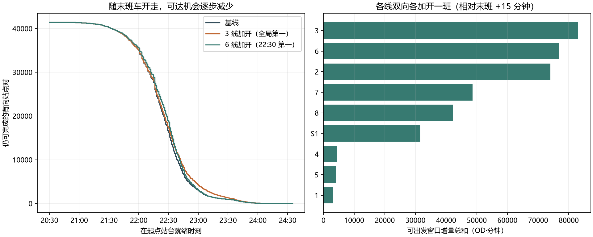

# 夜间换乘消融：最晚几点上车还能到？

**按本次 2026-11-23（周一）规划时刻，给 3 号线两个方向各加开一班晚 15 分钟的车，全网出发窗口增量最大。** 但如果只问「22:30 已在起点站台、还能到哪里」，6 号线新增的可达站点对最多；23:00 则是 3 号线最多。这里数的是站点对，不是乘客。

## 1. 班次怎么建，怎么消融

沿用[分钟线网](../results/metro.graphml)的 1–8 号线及 S1 站序和换乘连接，不用中午区间均值来推晚班时刻。输入有两份：

- [逐班逐站时刻](../data/night_trips.csv)：[MetroMan 合肥路线规划](https://www.metroman.cn/en/planner/hefei)的同车逐站显示。查询同一运营日各线双向全程，以及 1、4、5 号线从合肥南站出发的晚班区段。用 `last` 和从 19:20 起的多次 `depart` 查询补足衔接所需的早些班次；去掉同一趟车的重复结果和截取的后段，共 **449 趟**。每行的链接可回查，`stop_times` 按本趟运行区段站序排列。
- [逐站末班发车表](../data/night_last_departures.csv)：MetroMan 的站页，取对应周一适用的时刻。**432 条**站点—线路—方向末班发车与班次表重建结果逐条一致。两份数据都是同一第三方平台的交叉核对，并非实测或两家独立来源。时刻表运营日是 11 月 23 日，采集于 11 月 24 日；`24:06` 表示此运营日结束前的次日 00:06，不计次日早班。

每个能上车的事件都有发车时刻和所乘班次。**只消融已经离开本站的上车机会，不删整条线**：人在上游搭上末班车，仍可坐它到下游；在下游也可以等当地末班。跨线只允许在图中的换乘站，按 **5 分钟**缓冲；换另一趟同线列车按 1 分钟，原车续乘不加缓冲。规划器中间站只给一个分钟级时刻，暂作到发共用，没有实测停站和关门秒数。

按时间逆序计算「上这班车还能到哪些站」，再给每个**有向**站点对取可达的最晚首程发车。站台在该时刻前已就绪、且可等候时，便计为可达。这里算的不是进站截止时间，也不是到达目的站的时刻。

## 2. 晚上越晚，还有多少地方能去？

204 站共有 **41,412 个有向 OD**，基线每个都找到了至少一条当晚路线；各 OD 的最晚上车时刻介于 **20:54 和次日 00:19**。下表统计从指定时刻起、已经在起点站台，可以靠余下班次完成行程的站点对。

| 站台就绪时刻 | 可达 OD | 占全部有向 OD |
|---|---:|---:|
| 22:00 | 35,020 | 84.56% |
| 22:30 | 16,260 | 39.26% |
| 23:00 | 2,882 | 6.96% |
| 23:30 | 935 | 2.26% |

**算例：新桥 2 号航站楼 → 繁华大道。** S1 的末班 **22:30** 出发、**23:02** 到合肥西站，离 3 号线往省儿童医院新区方向末班 **23:05** 只有 3 分钟，按 5 分钟换乘来不及。基线最晚得搭 S1 的 **22:15** 班。给 3 号线加班后，合肥西站多出 **23:20** 的出发机会，S1 的 22:30 末班便能接上；预计 **23:43** 到繁华大道。

## 3. 哪条线增加 15 分钟最有贡献？

每次只改一条线，**保留原有所有班次**，两个方向各复制该方向最后一班的运行区段与逐站时刻，整体推迟 **15 分钟**。1、4、5 号线复制的是从合肥南站出发的末班区段，并非所有车站都延后 15 分钟。比较的是每条线各加两趟晚班的情景，不是同等运营成本。

| 加开线路 | 能更晚上车的 OD | 全网出发窗口增量（OD·分钟） | 22:30 新增可达 OD | 23:00 新增可达 OD |
|---|---:|---:|---:|---:|
| **3** | **5,898** | **83,085** | 1,007 | **1,263** |
| 6 | 5,499 | 76,685 | **2,352** | 98 |
| 2 | 5,258 | 73,997 | 673 | 1,054 |
| 7 | 2,944 | 48,626 | 424 | 0 |
| 8 | 2,947 | 42,180 | 537 | 20 |
| S1 | 1,869 | 31,604 | 105 | 26 |
| 4 | 295 | 4,425 | 0 | 0 |
| 5 | 276 | 4,140 | 0 | 0 |
| 1 | 221 | 3,159 | 0 | 0 |

全局排名把每个 OD 的「加班后最晚上车时刻 − 基线」相加，表示**新增出发机会的总量**，不是节约的运行时间。加晚班 15 分钟可能接上原来错过的一趟车，使上游的最晚上车时刻推迟超过 15 分钟。把跨线缓冲改为 4 或 6 分钟，3 号线仍排全局第一，2、6 号线的次序会变；4 分钟时，3 号线和 2 号线的差距很小。

### 2、3、6 号线：分别加开与一起加开

选全晚窗口增量最高的三条线，原车一律保留，同时为三条线的两个方向各加一趟（共 6 趟）。[逐分钟组合表](../results/night_ablation/three_line_reachability.csv)同时保存基线、三种单线方案、单线可达集合的并集，以及组合结果。

| 起点站台就绪 | 原班可达 | 三种单线方案取并 | 同时加开可达 | 任一单线都不行、组合才可达 |
|---|---:|---:|---:|---:|
| 22:30 | 16,260 | 20,215 | 20,496 | **281** |
| 23:00 | 2,882 | 5,252 | 5,526 | **274** |

22:30 时，三线同时加开比基线多 **4,236 对**。例如 22:30 从乐平去南岗，单独加开 2、3、6 的任何一条线都不通，但 2、3 一起加开能接通（最晚在乐平 22:41 上车）。因此不能把各线新增站对数直接相加，有重叠也有新接通的链。281 对不是“必须三条全加”的数；也不能把六趟和单线两趟当作同成本。

## 4. 合肥西站：等几分钟，还是另加一班？（历史方案，未纳入现版答辩）

**先核对时刻，不把它当成实测。** [合肥轨道交通发布的 S1 开通时刻表（转载）](https://feng.ifeng.com/c/8y9gPEGslOG)列出新桥 2 号航站楼末班 22:30、合肥西站往省中医院西区末班 23:02；[合肥本地宝 3 号线表](https://m.hf.bendibao.com/ditie/shike_326.shtml)列出合肥西站往省儿童医院新区末班 23:05，与 [MetroMan 站表](https://www.metroman.cn/en/cities/hefei/stations/hefei-xizhan-hefeixi-railway-station)吻合。这只能交叉核对公开时刻，不能独立确认 S1 到站开门、3 号线关门或站台间步行。以下以 23:02 作模型到站时刻。

**对照方法。** 只让 3 号线往省儿童医院新区的原末班在合肥西站多停 2、5 或 10 分钟。上游时刻和合肥西站到站时刻不变，只推迟本站发车及下游到发。加班对照则保留原车，沿同一方向另加一班晚 15 分钟的车；上一节的双向各加一班也列作参考。仍然对比 41,412 个等权有向 OD。

| 方案（跨线默认 5 分钟） | 合肥西站 3 号线末班发车 | 新桥 2 号航站楼→繁华大道最晚上车 | 最晚上车能推迟的 OD | 得提前上车的 OD | 全网出发窗口净增（OD·分钟） |
|---|---|---|---:|---:|---:|
| 不调整 | 23:05 | 22:15 | 0 | 0 | 0 |
| 多等 2 分钟 | 23:07 | 22:30 | 654 | 0 | 5,572 |
| 多等 5 分钟 | 23:10 | 22:30 | 1,928 | 0 | 16,720 |
| 多等 10 分钟 | 23:15 | 22:30 | 2,188 | **207** | 19,010 |
| 同方向加开一班 | 23:20 | 22:30 | 3,593 | 0 | 46,497 |
| 双向各加开一班 | 23:20 | 22:30 | 5,898 | 0 | 83,085 |

净增＝所有变晚窗口的增量减去所有变早窗口的减量；不是节省的乘车时间。没有 OD 完全失去当晚路线，但窗口提前意味着一部分较晚出发的行程已不可达。只把**合肥西站 S1→3 号线**缓冲从 3 试到 7 分钟：缓冲为 3 分钟时，基线理论上已能接上；多等 2 分钟只覆盖缓冲不超过 5 分钟的情景，多等 5 分钟在所测范围内均接得上。没实测之前，这不是换乘成功保证。

**多等 10 分钟的代价。** 3 号线原本 23:10 到西七里塘，等候 10 分钟后变为 23:20，按 5 分钟换乘，错过 2 号线往南岗方向 **23:24** 末班。例如合肥西站→南岗的最晚上车从 **23:05 提前到 22:55**。对 23:00 已在起点站台的行程，这一方案新增 190 对可达、也让 **36 对**原可达行程走不通。等 5 分钟在本模型中没有这种窗口损失，但仍会让留在原车、去下游的乘客晚到 5 分钟。

**建议优先现场验证「等 5 分钟」。** 在测试的等候方案中，它能覆盖机场末班的接驳，又没有缩短其他 OD 的出发窗口；若目标是扩大整晚的可达范围，保留原车另加一班收益更大。现场应从 S1 开门、下车开始计时，到 3 号线正确方向站台，并核对最后关门时刻。未测站内步行、未验证列车调度和加班成本，不能据此断言哪种方案更划算。

**范围**：结果只适用于这份周一规划时刻和指定方案，不是实时乘车指引。未补客流，不计车站关闸、站外步行、公路接驳及临时调度。

**结果与复现**：[全网 OD 最晚上车时刻及九种情景](../results/night_ablation/latest_boarding.csv) · [逐线路比较](../results/night_ablation/line_gain.csv) · [逐分钟可达曲线](../results/night_ablation/reachability.csv) · [合肥西站等候与加班对照](../results/night_ablation/west_station_hold.csv)。从仓库根目录运行 `python -m src.night_ablation`；要用不同缓冲另存一份，可加 `--transfer-minutes 4 --output results/night_ablation_4min`。
