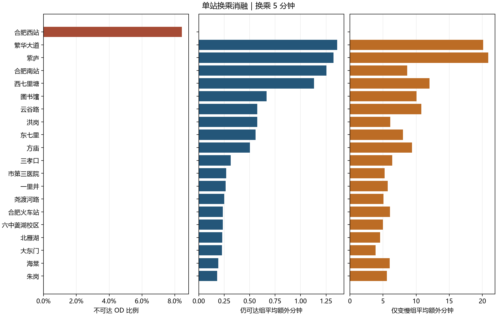
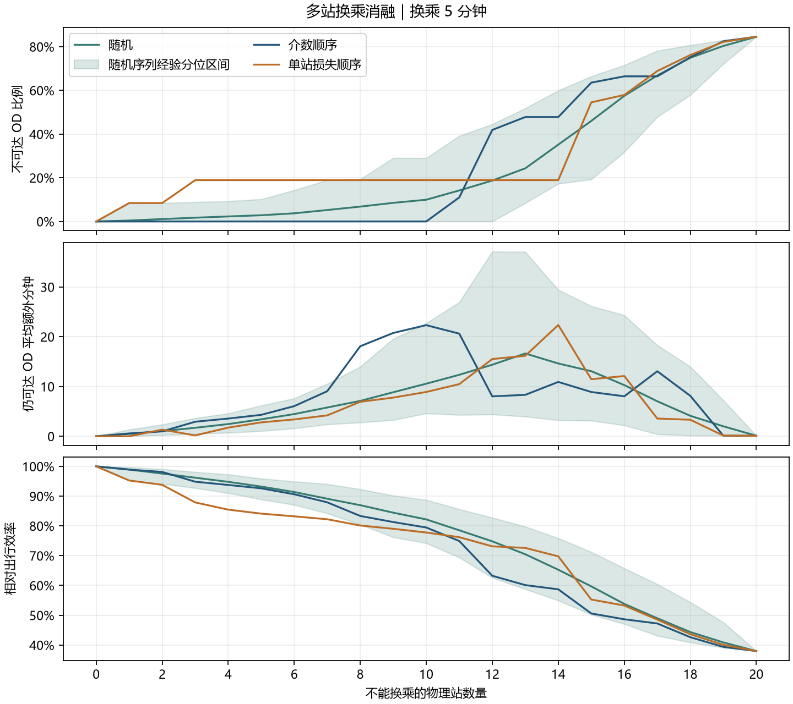

# 换乘消融实验

**问题：突发事故使一个站暂时不能换乘、但列车仍照常停靠时，乘客还能不能到？能到的要多花几分钟？多个站同时失去换乘时又会怎样？**

**最主要的发现**：合肥西站在模型中是 S1 唯一换乘口，单站消融就有 **1,746 对起终点失联（8.43%）**。合肥南站消融则没有失联，但 **3,003 对**行程变慢，这些行程平均多花 **8.65 分钟**。两个站影响不同，不能只用一个平均数衡量。

## 1. 怎么做

本实验沿用原 B/C 的单站与多站对照思路，改用[全线网分钟图](../results/metro.graphml)：1–8 号线和 S1、204 座物理站、225 个站点—线路节点。乘车边按双向逐站时刻估计耗时，换乘边基准 **5 分钟**；正常情况下，**20,706 对**无序物理起终点（OD）全部可达，模型平均最短代价为 **42.00 分钟**。每对 OD 等权，不代表实际客流。

- **消融单位是一座物理站**：同时关闭该站的全部双向换乘边，保留所有节点、列车运行边和正常上下车。以合肥南站为例，同时去掉 **1↔4、1↔5、4↔5**，不是关站，也不是分别做三次实验。旅客仍能从该站任一线路出发或到达。
- **计算最短时间**：对每个 OD，在站点—线路图上跑加权最短路，取起终点各自所有线路副本之间的最短分钟数，再与正常网络比较。**不可达单列**，不折成一个人为的分钟值。「仍可达组」均值含没变慢的行程，「仅变慢组」均值不含。
- **单站比较**：逐个关闭 20 座换乘站。单站损失顺序先按不可达对数、再按仍可达组平均额外分钟降序，最后用站名破并列。这个顺序优先识别完全走不通的情景，不是事故发生概率排名。另在不计权的物理站拓扑图上算介数，作为结构对照。
- **多站比较**：分别按上述单站损失、按原始介数、按 100 条随机排列，从 0 座逐步增至 20 座不能换乘；每条序列前一步已关闭的站不恢复。相对效率是全体 OD 的最短分钟数倒数均值（不可达贡献 0），再除以同一参数下的正常效率。以消融比例为横轴计算效率曲线面积（AUC）；越小表示全过程保留效率越少。

## 2. 单站：失联、变慢是不同的影响

| 不能换乘的站 | 删除换乘边 | 不可达 OD | 变慢 OD | 仍可达组平均额外分钟 | 仅变慢组平均额外分钟 |
|---|---:|---:|---:|---:|---:|
| 合肥西站 | 1 | 1,746 | 0 | 0.00 | — |
| 繁华大道 | 1 | 0 | 1,399 | 1.36 | 20.10 |
| 紫庐 | 1 | 0 | 1,313 | 1.32 | 20.88 |
| 合肥南站 | 3 | 0 | 3,003 | 1.25 | 8.65 |
| 洪岗 | 1 | 0 | 1,961 | 0.58 | 6.07 |

- **失联**：除合肥西站外，其余 19 座站单独消融都未造成 OD 失联。合肥西站是当前图里 3 号线与 S1 的唯一连接；S1 独有的 9 座站与其余不在 S1 上的 194 座站之间，**9 × 194 = 1,746** 对失联。其余可达行程不变，并不代表这次中断没有损失。
- **绕行**：合肥南站使最多 OD 变慢（**14.50%**），其中一条受影响较大的路线是**义兴 → 南屏路**：正常由 5 号线在合肥南站转 4 号线，约 **19 分钟**；不能在那里换乘后，经市第三医院换 6 号线、再经尧渡河路换 4 号线，约 **50 分钟（+31）**。这是一个算例，不是全站平均。
- **介数不能替代损失**：洪岗介数第 1、损失第 8；合肥西站介数第 13、损失第 1。两种排名的 Spearman 秩相关为 **0.346**，前五只重合合肥南站。经常经过某站和难以替代该站的换乘，是两件事。

## 3. 多站：为什么平均绕行下降，不一定是好消息？

| 中断顺序 | 1 站时不可达比例 | 3 站时不可达比例 | 10 站时不可达比例 | 相对效率 AUC |
|---|---:|---:|---:|---:|
| 随机（100 次平均） | 0.42% | 1.73% | 9.95% | 0.7603 |
| 原始介数 | 0.00% | 0.00% | 0.00% | 0.7277 |
| 单站损失 | 8.43% | 18.92% | 18.92% | 0.7252 |

按单站损失先遇到合肥西站，再到繁华大道、紫庐；后两站是 7 号线在图中的两个换乘口，**合在一起的影响不能把两次单站结果相加**。按介数顺序直到第 11 座才出现失联。两种固定顺序的全程效率面积都小于随机平均，本次单站损失顺序略低于介数顺序；差距不大，也没有穷举最坏组合。图中阴影是随机序列的 **2.5%–97.5% 经验分位区间**，不是置信区间。

**固定同一批起终点复核。** 在 5 分钟基准的两种固定顺序中，找出「不可达增加但平均绕行下降」最明显的一步：按介数从 11 座增至 12 座，新增方庙。

| 比较口径 | 11 座不能换乘 | 12 座不能换乘 |
|---|---:|---:|
| 仍可达 OD 数 | 18,426 | 12,032 |
| 各自仍可达组平均额外分钟 | 20.62 | 8.02 |
| **两步都可达的同一批 12,032 对**平均额外分钟 | **7.88** | **8.02** |
| 下一步失联的 6,394 对，平均额外分钟 | 44.58 | 不可达 |

**表面上的平均绕行下降，是因为许多原本绕路很远的行程已无路可走**；同一批仍能到的行程反而更慢。因此报告不能只给平均分钟数，必须同时给不可达比例。

## 4. 结论的适用范围

把换乘代价设为 **3、5、7 分钟**重测时，合肥西站始终排第一，单站前五成员相同、内部次序有变化。多站对照保持 5 分钟基准的中断顺序不变，两套固定顺序的全程效率面积在三种参数下都低于随机平均。换乘分钟改变路线优选，不改变固定关闭集合的连通关系。

这是**只关闭站内换乘功能**的情景研究，不是事故过程或实测乘客损失。结果依赖图中列示的换乘关系、估计区间耗时及等权 OD；不含站外重新进站、公交替代、实际客流、班次与事故导致的列车停运。适合发现哪些出行缺少地铁内替代路线，不适合据此推断实际受影响人数或直接决定工程优先级。

**方法参考**：[杜斐等：轨道网络鲁棒性与随机对照](https://doi.org/10.14188/j.1671-8844.2016-05-010) · [Wu 等：路径距离与换乘代价](https://doi.org/10.1016/j.physa.2017.08.074) · [Kopsidas 与 Kepaptsoglou：替代路径及关键站识别](https://doi.org/10.1016/j.physa.2022.127123)。

**复核**：[单站全表](../results/transfer_ablation/single_station.csv) · [多站汇总](../results/transfer_ablation/multi_station.csv) · [参数、固定站序、敏感性与固定样本摘要](../results/transfer_ablation/summary.json) · [数据来源与复现](../README.md)。
